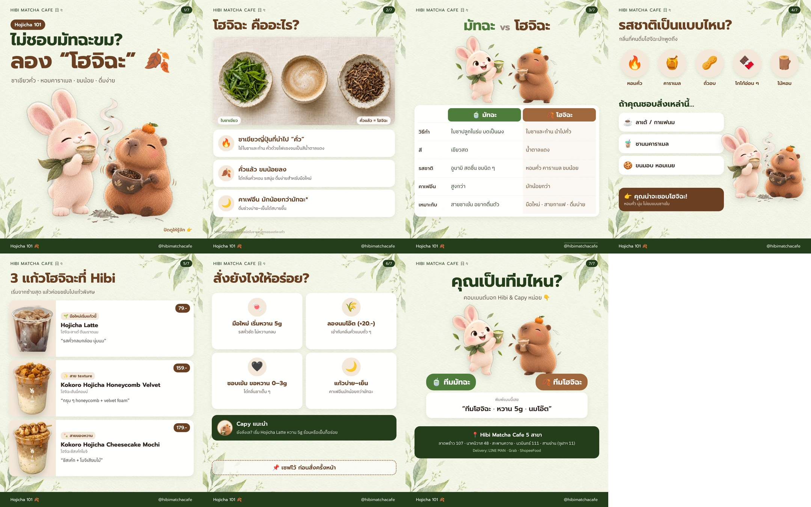

# IG Carousel · Hojicha 101 — “ไม่ชอบมัทฉะขม? ลอง โฮจิฉะ 🍂”

> ไฟล์โพสต์: `final/HIBI_HOJICHA_01.jpg` … `07.jpg` (1080×1350, 4:5) · ภาพรวม: `final/overview.jpg`
> ภาพตัวละคร/ภาพใบชา: Higgsfield gpt_image_2_5 (อ้างอิงชีต Hibi & Capy) · ตัวหนังสือไทยวางด้วย HTML (`build_slides.py`)



## ทำไมต้องทำ
- รายงานเทรนด์คาเฟ่ปี 2026 ระบุว่ายอดค้นหา hojicha latte เพิ่มขึ้นราว 173% และมองว่าเป็น “คลื่นลูกถัดไป” ต่อจากมัทฉะ — เหมาะกับคนที่รู้สึกว่ามัทฉะขม/คาเฟอีนแรง
- Hibi มีเมนูโฮจิฉะอยู่แล้ว 3 แก้ว → คอนเทนต์ความรู้ (สายเซฟ) ที่ปิดท้ายด้วยการขายของ

## โครงสไลด์
| # | เนื้อหา |
|---|---|
| 1 | ปก: “ไม่ชอบมัทฉะขม? ลอง โฮจิฉะ 🍂” + Capy คั่วชา · Hibi ดมกลิ่น |
| 2 | โฮจิฉะคืออะไร: ชาเขียวญี่ปุ่นที่นำไปคั่ว · ขมน้อยลง · คาเฟอีนมักน้อยกว่ามัทฉะ* (ภาพใบชาเขียว vs ใบชาคั่ว) |
| 3 | ตาราง มัทฉะ vs โฮจิฉะ: วิธีทำ · สี · รสชาติ · คาเฟอีน · เหมาะกับใคร |
| 4 | รสชาติ: หอมคั่ว · คาราเมล · ถั่วอบ · โกโก้อ่อน ๆ · ไม้หอม → “ถ้าชอบลาเต้/ชานมคาราเมล/ขนมอบ คุณน่าจะชอบโฮจิฉะ” |
| 5 | 3 แก้วโฮจิฉะที่ Hibi: Hojicha Latte 79.- · Kokoro Hojicha Honeycomb Velvet 159.- · Kokoro Hojicha Cheesecake Mochi 179.- |
| 6 | สั่งยังไงให้อร่อย (สไลด์เซฟ): หวาน 5g · นมโอ๊ต +20.- · ชอบเข้ม 0–3g · แก้วบ่าย–เย็น + Capy แนะนำ |
| 7 | CTA: ทีมมัทฉะ 🍵 vs ทีมโฮจิฉะ 🍂 + ตัวอย่างคอมเมนต์ + 5 สาขา |

## แคปชัน IG / FB
```
ไม่ชอบมัทฉะขม? ลอง “โฮจิฉะ” 🍂
ชาเขียวญี่ปุ่นที่นำไปคั่ว หอมคาราเมล ถั่วอบ ขมน้อย ดื่มง่าย
ใครชอบลาเต้ / ชานมคาราเมล บอกเลยว่าน่าจะถูกใจ ☕

📌 สไลด์ 6 = สูตรสั่งให้อร่อย เซฟไว้ใช้ครั้งหน้า
🍂 Hojicha Latte 79.- · Kokoro Honeycomb 159.- · Kokoro Cheesecake Mochi 179.-
📍 Hibi Matcha Cafe ทั้ง 5 สาขา · Delivery: LINE MAN / Grab / ShopeeFood

คุณทีมมัทฉะ 🍵 หรือทีมโฮจิฉะ 🍂? คอมเมนต์มาเลย 👇

#HibiMatcha #โฮจิฉะ #hojicha #hojichalatte #มัทฉะ #คาเฟ่กรุงเทพ
```
**คอมเมนต์ปักหมุด:** `ทีมโฮจิฉะ 🍂 หรือ ทีมมัทฉะ 🍵? บอกความหวานที่ชอบด้วยน้า~`

## ก่อนโพสต์
- [ ] ราคา 3 แก้วตรงทุกสาขา (อ้างอิงแผ่นเมนูสาขาสะพานควาย) และเมนู Kokoro ยังขายอยู่
- [ ] เช็กสต็อกโฮจิฉะกับซัพพลายเออร์ (ปี 2026 ผู้ผลิตญี่ปุ่นบางรายจำกัดสินค้าโฮจิฉะ) ก่อนดันโปรโมต
- [ ] ข้อมูลคาเฟอีน: เขียนแบบ “มักน้อยกว่า” + หมายเหตุว่าขึ้นกับใบชา/สูตร — ไม่ได้อ้างตัวเลข
- [ ] ภาพตัวละครสร้างด้วย AI → เปิดป้าย AI info ใน IG
