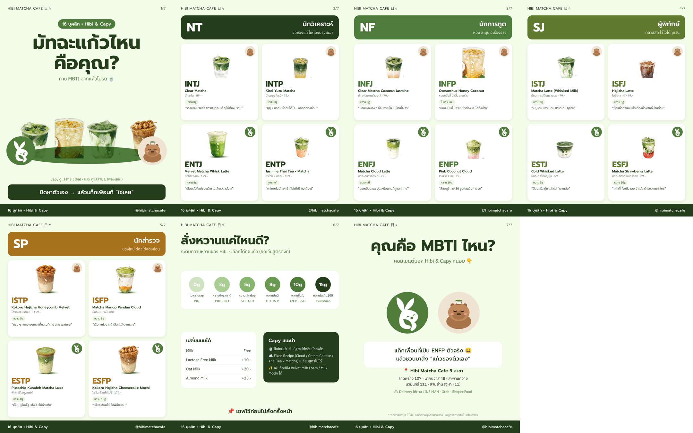

# IG Carousel · มัทฉะแก้วไหนคือคุณ? (16 บุคลิก × Hibi & Capy) — v2 เมนูจริง

> แทนตาราง 16 บุคลิกใน [../mbti-matcha.md](../mbti-matcha.md) (v1 ใช้เมนูสมมติ) · ภาพ mockup 7 สไลด์ 1080×1350 อยู่ในโฟลเดอร์นี้



## 1. คอนเซปต์ตัวละคร
| ตัวละคร | บุคลิก | หน้าที่ในคอนเทนต์ |
|---|---|---|
| **Hibi** (กระต่าย — โลโก้ร้าน) | พลังเยอะ ช่างอยากรู้ ร่าเริง | ดูแลบุคลิก **สาย E** (Extrovert) — ไอคอนมุมการ์ด |
| **Capy** (คาปิบาร่า) | ชิล ใจเย็น ไม่รีบ | ดูแลบุคลิก **สาย I** (Introvert) — ไอคอนมุมการ์ด |

ทุกการ์ดจึงตอบได้ 2 ชั้น: “แก้วไหนคือฉัน” + “ฉันเป็นทีม Hibi หรือทีม Capy” → คอมเมนต์ได้ง่ายขึ้นอีกทาง (“ทีม Capy ค่ะ 🙋”)

## 2. 16 บุคลิก × เมนูจริง

| MBTI | แก้ว | ราคา | ความหวานแนะนำ | ทีม | หนึ่งบรรทัด |
|---|---|---|---|---|---|
| **NT · นักวิเคราะห์** — ขอของแท้ ไม่ต้องปรุงเยอะ |||||
| INTJ | Clear Matcha (มัทฉะใส) | 59.- | 0g | Capy | วางแผนมาแล้ว ขอรสมัทฉะแท้ ๆ ไม่ต้องหวาน |
| INTP | Kirei Yuzu Matcha | 79.- | 3g | Capy | ยูซุ + มัทฉะ เข้ากันได้ไง… ขอทดลองก่อน |
| ENTJ | Velvet Matcha Whisk Latte (Cold Foam) | 129.- | 5g | Hibi | เลือกตัวท็อปของร้าน ไม่เสียเวลาลังเล |
| ENTP | Jasmine Thai Tea × Matcha Latte | 109.- | สูตรคงที่ | Hibi | ชาไทยกับมัทฉะเข้ากันไม่ได้? ขอเถียง! |
| **NF · นักการทูต** — หอม ละมุน มีเรื่องราว |||||
| INFJ | Clear Matcha Coconut Jasmine | 79.- | 3g | Capy | หอมมะลิบาง ๆ ลึกหลายชั้น เหมือนใจเรา |
| INFP | Osmanthus Honey Coconut | `[ราคา]` | ไม่หวานเกิน | Capy | หอมหมื่นลี้ นั่งริมหน้าต่าง ฝันได้ทั้งบ่าย |
| ENFJ | Matcha Cloud Latte | 79.- | สูตรคงที่ | Hibi | นุ่มเหมือนเมฆ อุ่นเหมือนคนที่ดูแลทุกคน |
| ENFP | Pink Coconut Cloud | 79.- | 10g | Hibi | สีชมพู! ถ่าย 30 รูปก่อนจิบคำแรก |
| **SJ · ผู้พิทักษ์** — คลาสสิก ไว้ใจได้ทุกวัน |||||
| ISTJ | Matcha Latte (Whisked Milk) | 79.- | 8g | Capy | เมนูเดิม หวานเดิม สาขาเดิม ทุกวัน |
| ISFJ | Hojicha Latte | 79.- | 5g | Capy | ซื้อแก้วตัวเองแล้ว ต้องซื้อฝากที่บ้านด้วย |
| ESTJ | Cold Whisked Latte | 59.- | 5g | Hibi | ตีสด เร็ว คุ้ม แล้วไปทำงานต่อ |
| ESFJ | Matcha Strawberry Latte | 89.- | 10g | Hibi | แก้วที่ทั้งแก๊งชอบ จำได้ว่าใครหวานเท่าไหร่ |
| **SP · นักสำรวจ** — ของใหม่ ต้องได้ลองก่อน |||||
| ISTP | Kokoro Hojicha Honeycomb Velvet | 159.- | 5g | Capy | กรุบ ๆ honeycomb เคี้ยวไปคิดไป สาย texture |
| ISFP | Matcha Mango Pandan Cloud | `[ราคา]` | 8g | Capy | เลือกแก้วจากสี เลือกโต๊ะจากแสง |
| ESTP | Pistachio Kunafeh Matcha Luxe | `[ราคา]` | 8g | Hibi | เห็นเมนูใหม่ปุ๊บ สั่งปั๊บ ไม่อ่านต่อ |
| ESFP | Kokoro Hojicha Cheesecake Mochi | 179.- | 10g | Hibi | มีโมจิเสียบไม้! ไลฟ์ก่อนกิน |

ระดับความหวาน/นม/ท็อปปิ้ง อ้างอิงเมนูจริง (0/3/5/8/10/15g · Lactose Free +10 · Oat +20 · Almond +25) · Fixed Recipe (Cloud Latte, Thai Tea × Matcha) เปลี่ยนสูตรไม่ได้ จึงเขียนว่า “สูตรคงที่”

## 3. โครงสไลด์ (1080×1350)
| สไลด์ | เนื้อหา | หมายเหตุออกแบบ |
|---|---|---|
| S1 ปก | “มัทฉะแก้วไหน คือคุณ?” · ชิป “16 บุคลิก × Hibi & Capy” · 4 แก้วตัวแทน 4 กลุ่มบนใบไม้เขียว · Hibi ซ้าย Capy ขวา · “Capy ดูแลสาย I · Hibi ดูแลสาย E” | ตัวหนังสือปกใหญ่ อ่านได้ใน 1 วิ |
| S2–S5 | แถบกลุ่ม (สีตามกลุ่ม) + การ์ด 2×2: ภาพแก้ว · MBTI ตัวใหญ่ · ชื่อเมนู · ราคา · ชิปความหวาน · หนึ่งบรรทัด · ไอคอน Hibi/Capy มุมขวาบน | สี: NT `#243e1b` · NF `#4e7c3a` · SJ `#5f7a2e` · SP `#a8721c` |
| S6 | “สั่งหวานแค่ไหนดี?” แถบ 0–15g พร้อมบุคลิกที่แนะนำ · ตารางเปลี่ยนนม · กล่อง “Capy แนะนำ” | สไลด์ **เซฟ** — ใช้ซ้ำได้ |
| S7 | “คุณคือ MBTI ไหน?” · Hibi + Capy · “แท็กเพื่อนที่เป็น ENFP ตัวจริง” · 5 สาขา · Delivery | หมายเหตุ “เพื่อความสนุก… เมนูอาจต่างกันในแต่ละสาขา” |

พื้น `#f3fbe9` (มินต์ตามโพสต์ร้าน) · หัวข้อ Prompt Bold · เนื้อหา IBM Plex Sans Thai · Footer เขียวเข้มแบบเดียวกับโพสต์ร้าน

## 4. แคปชัน IG
```
มัทฉะแก้วไหนคือคุณ? 🍵 16 บุคลิกฉบับ Hibi & Capy
ปัดหาตัวเองให้เจอ แล้วแท็กเพื่อนที่ “ใช่เลย” 👀

INTJ → Clear Matcha หวาน 0% ไม่ต้องปรุง
ENFP → Pink Coconut Cloud ถ่าย 30 รูปก่อนจิบ
ESFP → Kokoro Cheesecake Mochi มีโมจิเสียบไม้ต้องไลฟ์!

สาย I ไปอยู่ทีม Capy สาย E ไปอยู่ทีม Hibi
คอมเมนต์ MBTI ของคุณ + ทีมของคุณมาเลย 👇

📌 สไลด์ 6 = สูตรสั่งความหวาน เซฟไว้ใช้ครั้งหน้า
📍 Hibi Matcha Cafe ทั้ง 5 สาขา · Delivery: LINE MAN / Grab / ShopeeFood

*เพื่อความสนุกนะ~ ไม่ใช่แบบทดสอบจริง

#HibiMatcha #HibiAndCapy #MBTI #16บุคลิก #มัทฉะ #คาเฟ่กรุงเทพ #matcha
```
**คอมเมนต์ปักหมุด:** `ทีม Capy 🌿 หรือ ทีม Hibi 🐰 คุณอยู่ทีมไหน? บอก MBTI มาด้วยน้า~`

## 5. ส่งต่อทีม (สถานะ mockup)
- ภาพแก้วตัดจากโปสเตอร์/เมนูที่ร้านส่งมา → **ไฟล์จริงให้ใช้ภาพต้นฉบับความละเอียดสูง** (ภาพจากแผ่นเมนูเล็กจะแตกเมื่อขยาย: Clear Matcha, Kirei Yuzu, Coconut Jasmine, Cloud Latte, Pink Coconut Cloud, Matcha Latte, Hojicha Latte, Cold Whisked, Strawberry, Thai Tea × Matcha)
- **Capy ใน mockup เป็นภาพวาดชั่วคราว** → แทนด้วยภาพ Capy ทางการ · Hibi ใช้โลโก้ร้าน (ถ้ามีภาพ Hibi ตัวเต็มให้ใช้แทน)
- ยืนยัน: ราคา Osmanthus Honey Coconut / Mango Pandan Cloud / Pistachio Kunafeh · ทุกเมนูมีครบทุกสาขาไหม (แผ่นเมนูระบุ “Saphan Khwai x Hibi”)
- ผู้รับผิดชอบ: 🤖 AI = แคปชัน + ร่าง layout (ไฟล์นี้) · 👤 น้อง Year = เปลี่ยนภาพเป็นไฟล์จริง, ใส่ Capy ทางการ, ตรวจราคา, export
