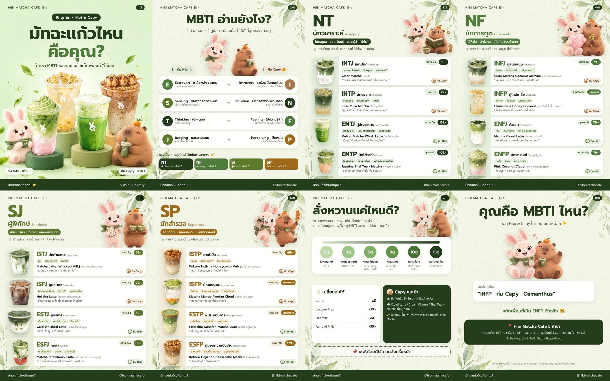

# IG Carousel · มัทฉะแก้วไหนคือคุณ? (16 บุคลิก × Hibi & Capy) — ฉบับพร้อมโพสต์

> ไฟล์โพสต์: `final/HIBI_MBTI_01.jpg` … `08.jpg` (1080×1350, 4:5) · ภาพแก้วตัดพื้นหลังแล้ว (PNG โปร่งใส): `drinks/` · สร้างใหม่ได้ด้วย `build_slides.py`



## 1. คอนเซปต์ตัวละคร
> ใช้ตามชีตตัวละครทางการ: `characters/hibi_sheet.png` (กระต่ายขนฟู สีครีม-ชมพู ผ้าพันคอใบชาเขียว) · `characters/capy_sheet.png` (คาปิบาร่าขนฟู สีคาราเมล ส้มบนหัว) · ไอคอนหน้าในสไลด์: `characters/*_face.png`

| ตัวละคร | บุคลิก | หน้าที่ในคอนเทนต์ |
|---|---|---|
| **Hibi** (กระต่าย — โลโก้ร้าน) | พลังเยอะ ช่างอยากรู้ ร่าเริง | ดูแลบุคลิก **สาย E** (Extrovert) — ไอคอนมุมการ์ด |
| **Capy** (คาปิบาร่า) | ชิล ใจเย็น ไม่รีบ | ดูแลบุคลิก **สาย I** (Introvert) — ไอคอนมุมการ์ด |

ทุกการ์ดจึงตอบได้ 2 ชั้น: “แก้วไหนคือฉัน” + “ฉันเป็นทีม Hibi หรือทีม Capy” → คอมเมนต์ได้ง่ายขึ้นอีกทาง (“ทีม Capy ค่ะ 🙋”)

## 2. 16 บุคลิก × เมนูจริง

| MBTI | ฉายา | แก้ว | ราคา | ความหวานแนะนำ | ทีม | หนึ่งบรรทัด |
|---|---|---|---|---|---|---|
| **NT · นักวิเคราะห์** — ขอของแท้ ไม่ต้องปรุงเยอะ ||||||
| INTJ | สถาปนิก (Architect) | Clear Matcha (มัทฉะใส) | 59.- | 0g | Capy | วางแผนมาแล้ว ขอรสมัทฉะแท้ ๆ ไม่ต้องหวาน |
| INTP | นักตรรกะ (Logician) | Kirei Yuzu Matcha | 79.- | 3g | Capy | ยูซุ + มัทฉะ เข้ากันได้ไง… ขอทดลองก่อน |
| ENTJ | ผู้บัญชาการ (Commander) | Velvet Matcha Whisk Latte (Cold Foam) | 129.- | 5g | Hibi | เลือกตัวท็อปของร้าน ไม่เสียเวลาลังเล |
| ENTP | นักโต้วาที (Debater) | Jasmine Thai Tea × Matcha Latte | 109.- | สูตรคงที่ | Hibi | ชาไทยกับมัทฉะเข้ากันไม่ได้? ขอเถียง! |
| **NF · นักการทูต** — หอม ละมุน มีเรื่องราว ||||||
| INFJ | ผู้สนับสนุน (Advocate) | Clear Matcha Coconut Jasmine | 79.- | 3g | Capy | หอมมะลิบาง ๆ ลึกหลายชั้น เหมือนใจเรา |
| INFP | ผู้ไกล่เกลี่ย (Mediator) | Osmanthus Honey Coconut | `[ราคา]` | ไม่หวานเกิน | Capy | หอมหมื่นลี้ นั่งริมหน้าต่าง ฝันได้ทั้งบ่าย |
| ENFJ | ตัวเอก (Protagonist) | Matcha Cloud Latte | 79.- | สูตรคงที่ | Hibi | นุ่มเหมือนเมฆ อุ่นเหมือนคนที่ดูแลทุกคน |
| ENFP | นักรณรงค์ (Campaigner) | Pink Coconut Cloud | 79.- | 10g | Hibi | สีชมพู! ถ่าย 30 รูปก่อนจิบคำแรก |
| **SJ · ผู้พิทักษ์** — คลาสสิก ไว้ใจได้ทุกวัน ||||||
| ISTJ | นักคำนวณ (Logistician) | Matcha Latte (Whisked Milk) | 79.- | 8g | Capy | เมนูเดิม หวานเดิม สาขาเดิม ทุกวัน |
| ISFJ | ผู้ปกป้อง (Defender) | Hojicha Latte | 79.- | 5g | Capy | ซื้อแก้วตัวเองแล้ว ต้องซื้อฝากที่บ้านด้วย |
| ESTJ | ผู้บริหาร (Executive) | Cold Whisked Latte | 59.- | 5g | Hibi | ตีสด เร็ว คุ้ม แล้วไปทำงานต่อ |
| ESFJ | กงสุล (Consul) | Matcha Strawberry Latte | 89.- | 10g | Hibi | แก้วที่ทั้งแก๊งชอบ จำได้ว่าใครหวานเท่าไหร่ |
| **SP · นักสำรวจ** — ของใหม่ ต้องได้ลองก่อน ||||||
| ISTP | ช่างฝีมือ (Virtuoso) | Kokoro Hojicha Honeycomb Velvet | 159.- | 5g | Capy | กรุบ ๆ honeycomb เคี้ยวไปคิดไป สาย texture |
| ISFP | นักผจญภัย (Adventurer) | Matcha Mango Pandan Cloud | `[ราคา]` | 8g | Capy | เลือกแก้วจากสี เลือกโต๊ะจากแสง |
| ESTP | ผู้ประกอบการ (Entrepreneur) | Pistachio Kunafeh Matcha Luxe | `[ราคา]` | 8g | Hibi | เห็นเมนูใหม่ปุ๊บ สั่งปั๊บ ไม่อ่านต่อ |
| ESFP | ผู้มอบความบันเทิง (Entertainer) | Kokoro Hojicha Cheesecake Mochi | 179.- | 10g | Hibi | มีโมจิเสียบไม้! ไลฟ์ก่อนกิน |

ระดับความหวาน/นม/ท็อปปิ้ง อ้างอิงเมนูจริง (0/3/5/8/10/15g · Lactose Free +10 · Oat +20 · Almond +25) · Fixed Recipe (Cloud Latte, Thai Tea × Matcha) เปลี่ยนสูตรไม่ได้ จึงเขียนว่า “สูตรคงที่”

## 3. โครงสไลด์ (1080×1350 · 8 สไลด์)
| สไลด์ | เนื้อหา | หมายเหตุออกแบบ |
|---|---|---|
| S1 ปก | “มัทฉะแก้วไหน คือคุณ?” · 4 แก้วจริงบนแท่นพาสเทล · Hibi ซ้าย / Capy ขวา · ป้าย “ทีม Hibi · สาย E / ทีม Capy · สาย I” | ฉากหลัง Higgsfield + ตัวหนังสือไทยวางทับ (`cover_src/`) |
| S2 **MBTI อ่านยังไง?** | 4 คู่ตัวอักษร E/I · S/N · T/F · J/P พร้อมคำอธิบายสั้นแบบสายคาเฟ่ · ภาพ Hibi กระโดด (E) vs Capy จิบชาเงียบ ๆ (I) · ทางลัด 4 กลุ่ม → สไลด์ 3–6 | สไลด์ปูพื้น ให้คนไม่รู้จัก MBTI อ่านต่อได้ |
| S3–S6 | หัวกลุ่ม (NT/NF/SJ/SP + ชื่อ TH/EN + คีย์เวิร์ดกลุ่ม + สายมัทฉะ) · ภาพ Hibi & Capy ตามธีมกลุ่ม · การ์ด 4 ใบ: แก้ว · MBTI + ฉายา TH/EN · **นิสัย 3 คำ** · เมนู EN/TH · หนึ่งบรรทัด · ความหวาน · ราคา · ทีม | ธีมภาพ: NT แว่น+หนังสือ+หลอดไฟ · NF หัวใจ+หอมหมื่นลี้ · SJ เช็กลิสต์+ถาดมัทฉะ · SP กล้อง+โมจิ |
| S7 | “สั่งหวานแค่ไหนดี?” 0–15g + MBTI ที่แนะนำ · เปลี่ยนนม · Capy แนะนำ · ภาพ Capy ตีมัทฉะ + Hibi ใส่น้ำตาล | สไลด์ **เซฟ** |
| S8 | “คุณคือ MBTI ไหน?” · Hibi & Capy โบกมือ · ตัวอย่างคอมเมนต์ · 5 สาขา · Delivery | หมายเหตุ “เพื่อความสนุก…” |

พื้นกระดาษมินต์ + ใบชาสีน้ำ (Higgsfield) · ภาพตัวละครทุกสไลด์สร้างด้วย Higgsfield ตามชีตทางการ แล้วตัดพื้นหลัง (`characters/art/`) · ตัวหนังสือทั้งหมดวางด้วย HTML (Prompt / IBM Plex Sans Thai) ให้คมและสะกดถูก

## 4. แคปชัน IG
```
มัทฉะแก้วไหนคือคุณ? 🍵 16 บุคลิกฉบับ Hibi & Capy
ไม่รู้จัก MBTI? เริ่มที่สไลด์ 2 ก่อนเลย
ปัดหาตัวเองให้เจอ แล้วแท็กเพื่อนที่ “ใช่เลย” 👀

INTJ → Clear Matcha หวาน 0% ไม่ต้องปรุง
ENFP → Pink Coconut Cloud ถ่าย 30 รูปก่อนจิบ
ESFP → Kokoro Cheesecake Mochi มีโมจิเสียบไม้ต้องไลฟ์!

สาย I ไปอยู่ทีม Capy สาย E ไปอยู่ทีม Hibi
คอมเมนต์ MBTI ของคุณ + ทีมของคุณมาเลย 👇

📌 สไลด์ 7 = สูตรสั่งความหวาน เซฟไว้ใช้ครั้งหน้า
📍 Hibi Matcha Cafe ทั้ง 5 สาขา · Delivery: LINE MAN / Grab / ShopeeFood

*เพื่อความสนุกนะ~ ไม่ใช่แบบทดสอบจริง

#HibiMatcha #HibiAndCapy #MBTI #16บุคลิก #มัทฉะ #คาเฟ่กรุงเทพ #matcha
```
**คอมเมนต์ปักหมุด:** `ทีม Capy 🌿 หรือ ทีม Hibi 🐰 คุณอยู่ทีมไหน? บอก MBTI มาด้วยน้า~`

## 5. การปรับภาพเมนู (ทำแล้ว)
- ตัดภาพแก้วทั้ง 16 เมนูจากโปสเตอร์/แผ่นเมนูของร้าน → **ขยายความละเอียด 4× ด้วย Real-ESRGAN** (ภาพจากแผ่นเมนูเดิมกว้างแค่ ~100–160px) → **ตัดพื้นหลังเป็น PNG โปร่งใส** ด้วย rembg → ใส่เงาตกใน layout
- ใช้ซ้ำได้กับโพสต์อื่นทั้งหมด (โฟลเดอร์ `drinks/`)
- ⚠️ ภาพที่มาจากแผ่นเมนูเล็ก (Clear Matcha, Kirei Yuzu, Coconut Jasmine, Cloud Latte, Pink Coconut Cloud, Matcha Latte, Hojicha Latte, Cold Whisked, Strawberry, Thai Tea × Matcha) ผ่านการขยายด้วย AI — รายละเอียดเล็ก ๆ อาจไม่ตรง 100% · ถ้าร้านมีไฟล์ภาพต้นฉบับความละเอียดสูง ให้วางทับใน `drinks/` ชื่อเดิม แล้วรัน `build_slides.py` ใหม่

## 6. ก่อนกดโพสต์ (เช็ก 1 นาที)
- [ ] ราคาในสไลด์ตรงกับทุกสาขา (แผ่นเมนูอ้างอิงเป็นของสาขาสะพานควาย)
- [ ] Osmanthus Honey Coconut / Mango Pandan Cloud / Pistachio Kunafeh ยังขายอยู่ (ในสไลด์แสดงป้าย “เมนูแนะนำ / Signature” แทนราคา)
- [ ] ปก (S1) เป็นภาพสร้างด้วย AI — Hibi & Capy วาดตามชีตตัวละครทางการ, แก้วในปก AI วาดใหม่จากภาพจริง → เช็กว่าหน้าตาแก้วใกล้ของจริงพอ · พิจารณาเปิดป้าย “AI info” ใน IG สำหรับโพสต์นี้
- [ ] ภาพแก้วในสไลด์ 3–6 เป็นภาพสินค้าจริงที่ขยายความละเอียด (ไม่ได้สร้างใหม่) · ภาพตัวละครในทุกสไลด์สร้างด้วย AI
- [ ] วางคอมเมนต์ปักหมุดทันทีหลังโพสต์

ผู้รับผิดชอบ: 🤖 AI = ปรับภาพ, ออกแบบ, แคปชัน (เสร็จแล้ว) · 👤 น้อง Year = เช็กข้อ 6 แล้วโพสต์
